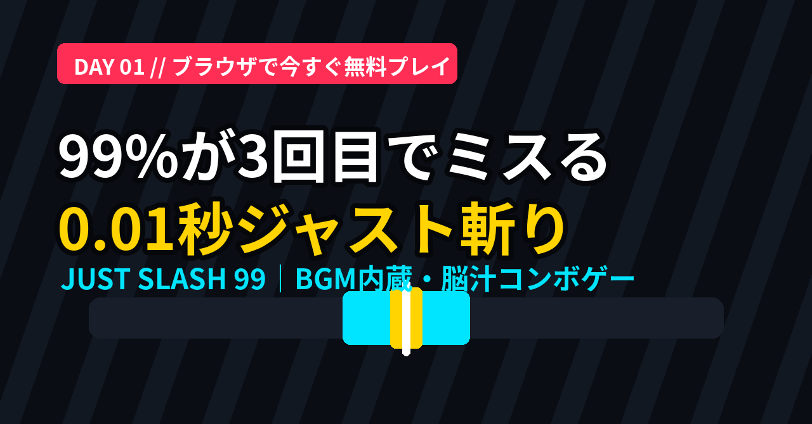

**「あと1ミリだったのに…！」**

そう言いながら、気づいたら10回連続でリトライしてしまう。  
外部ライブラリ・ビルド不要・**HTML 1ファイル完結**の脳汁特化型タイミングゲーム『**JUST SLASH 99**』を作りました！

GitHub Pages でスマホ・PCどちらからでもそのまま無料で遊べます👇

**▶ ブラウザで今すぐ遊ぶ**  
https://kam2525-hub.github.io/note_create_use/games/day01-just-slash/

（ソースコード全体も[GitHubリポジトリ](https://github.com/kam2525-hub/note_create_use)で公開しています）

---

## ゲームのルールは「2つだけ」

1. 左右に爆速で走る光のバーが、**中心の GOLD ゾーン** に重なった瞬間にタップ（PCは Space キー）
2. 5連続成功で **「FEVER TIME」** に突入し、スコア2倍＆BGMがギアアップ

ただし、たまに **「赤い TRAP ゾーン」** が出現します。  
赤いときにうっかり押してしまうと即ミス！見送ってスルーできればボーナス得点になります。

---

## 技術的なこだわり（なぜ HTML 1ファイルで気持ちいいのか）

短いプレイ時間でも爽快感が出るように、以下の仕組みをすべてバニラ JS ＋ Canvas ＋ Web Audio API で実装しています。

- **音声ファイルゼロのリアルタイムBGM＆SE（Web Audio API）**
  外部の `.mp3` / `.wav` を読み込まず、`OscillatorNode` で158 BPM のシンセBGM・コンボ音・斬撃音を動的生成しています。コンボが繋がるほどヒット音の音階が上がり（ド→レ→ミ→ファ…）、視覚だけでなく聴覚からも達成感が返ってくる設計です。
- **0.03秒のヒットストップ ＋ 画面シェイク（HTML5 Canvas）**
  ど真ん中の `GOD` 判定が決まった瞬間だけ物理更新を一瞬止め（ヒットストップ）、斬撃ライン・衝撃波・パーティクルを描画することで「斬った手応え」を作っています。
- **0.1秒でリスタートできるループ設計**
  ミスした瞬間に Space キー／ボタン1回で即リトライできるため、待ち時間ゼロで何度でも挑戦できます。

---

## あなたは何点いける？

- **2,200点以上**：Aランク（超反応スナイパー）
- **4,500点以上**：Sランク（脳汁ドバドバの覇者）
- **8,000点以上**：S++ランク（人間卒業・0.01秒の神）

まずは **Sランク（4,500点）** を目指して遊んでみてください！
